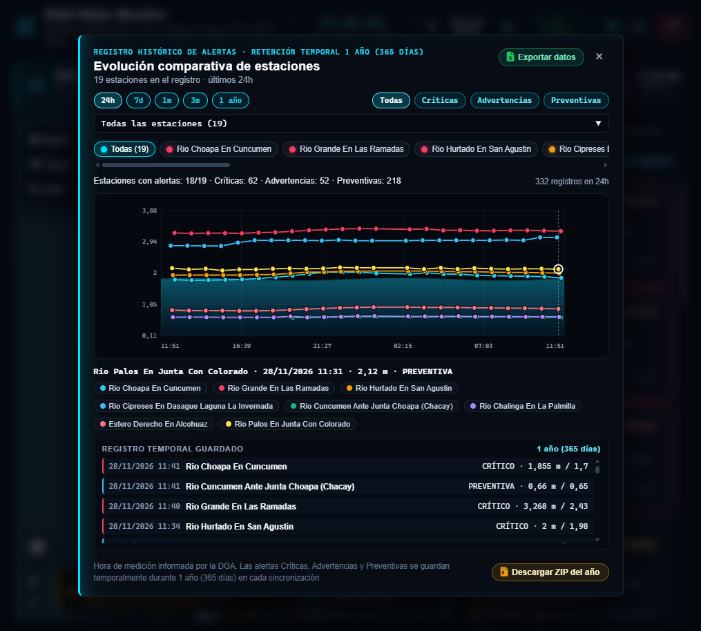

# DGA Water Monitor

Aplicación web de monitoreo hidrométrico y alertas en tiempo real para **ríos, caudales y embalses de Chile**, conectada directamente con los servicios públicos de la **Dirección General de Aguas (DGA - MOP Chile)**.

> **Aviso importante:** Esta web es una herramienta informativa y **no reemplaza las alertas de SENAPRED ni de las autoridades**. Ante riesgo real, prioriza siempre los canales oficiales de emergencia.



---

## Guía rápida y didáctica de uso

1. **Vista inicial nacional:** Al abrir la aplicación se cargan automáticamente las **16 regiones de Chile** enfocadas en **ríos activos con registro**, con mapa en modo oscuro por defecto y un reloj oficial de Chile (`America/Santiago`) en la barra superior.
2. **Tarjetas KPI superiores:** Muestran el resumen en vivo (ríos activos, estaciones inactivas o sin registro, embalses/lagos y alertas por severidad). Al hacer clic en una tarjeta KPI puedes segmentar el mapa y el listado lateral, mientras que **Última sincronización** se mantiene fija como referencia horaria.
3. **Buscador global inteligente:** Escribe el nombre, comuna o código BNA de cualquier río, embalse o estación (incluidas las **inactivas**) sin importar el filtro activo. Navega la lista sugerida con el **scroll del mouse** o las **flechas del teclado (`↑`/`↓` + `Enter`)** para volar directo al punto.
4. **Tarjetas emergentes y detalle (`#modal-station`):**
   - Muestra el estado operativo real (**`ACTIVA`** en verde / **`INACTIVA`** en gris) y el nivel de alerta resaltado por color.
   - Permite **volar al punto**, abrir la ubicación exacta en **Google Maps Satelital** en una nueva pestaña, saltar a **estaciones cercanas** (incluso si están ocultas por el filtro activo) y configurar **umbrales personalizados**.
5. **Historial temporal de 30 días y gráfico animado:** Desde **Historial alertas** (barra superior) o **Evolución** (en estaciones con alerta) se despliega un gráfico SVG interactivo con **animación de nivel de agua tipo estanque** en ventanas de **24 h**, **7 días** y **30 días**, tanto en vista comparativa (**Todas**) como individual.
6. **Alertas en tiempo real y notificaciones:** Las alertas activas se ordenan siempre de **Crítica (con contorno rojo pulsante) → Advertencia → Preventiva (de la medición más reciente a la más antigua)**, acompañadas por sonido configurable y **notificaciones de escritorio del navegador** adaptadas al color y prioridad de las 3 alertas más graves.

---

## Novedades recientes (`v3.1.0`)

- **Exportación nativa a Excel (`.xlsx`) y Respaldo Anual (`.zip`):**
  - Botón **Exportar datos** en el encabezado del modal histórico (`GET /api/alertas/historial/export`) que genera planillas `.xlsx` nativas en memoria usando únicamente la librería estándar de Python (`zipfile` + `xml.sax.saxutils`), sin dependencias externas.
  - Retención extendida a **1 año (365 días)** con selectores **`24h`**, **`7d`**, **`1m`**, **`3m`** y **`1 año`**.
  - Archivo automático anual en `data/history_archives/alerts_history_<año>.zip` (conteniendo el `.xlsx` interno) y botón directo **Descargar ZIP del año** en el pie del modal (`GET /api/alertas/historial/archivo-zip`).
- **Sensor de medición y formato de fechas chileno (`DD/MM/YYYY HH:MM:SS`):**
  - Popups del mapa y modal de detalle ahora muestran el **Sensor medición** (`Limnímetro / Nivel (m)` o `Caudalímetro (m³/s)`), la unidad en alertas DGA y la fecha de medición formateada.
  - Todas las fechas en UI (`fmtDateCL`) y en exportación `.xlsx` (`_format_xlsx_datetime`) se normalizan a `DD/MM/YYYY HH:MM:SS`.
- **Notificaciones en segundo plano:** Corrección del polling en `schedulePoll()` para mantener activas las consultas y notificaciones de escritorio incluso cuando la pestaña está oculta o el navegador minimizado.

### Cambios anteriores (`v3.0.0`)

- **Trazado geográfico exacto de ríos en alerta (`MAPA_BASE/RED_HIDROGRAFICA` 1:250k):** Los ríos con alertas **Críticas (rojo)**, **Advertencias (ámbar)** y **Preventivas (azul/cian)** ahora se destacan directamente sobre el mapa siguiendo el cauce oficial del MOP con polilíneas animadas, halos pulsantes y tooltips interactivos (`/api/alertas/cauces` + caché local en `data/rivers_cache.json`).
- **Galería de Sonidos de Alerta (Web Audio API):** Nuevo panel desplegable junto a la campana para elegir y probar tonos sintetizados diferenciados por severidad, incluyendo alarma crítica estilo **Sirena Nuclear / Klaxon Bunker / Alerta Geiger**, tonos ámbar de **Advertencia** y chimes suaves **Preventivos** (persistidos en `localStorage`).
- **Segmentación regional y filtros consistentes:**
  - Al seleccionar una región, las tarjetas KPI contabilizan exclusivamente las estaciones, embalses y alertas de esa región y el segmentador vuelve a **Todos** por defecto.
  - Al filtrar por tarjetas de alerta en el mapa (`Críticas`, `Advertencias`, `Preventivas`), el mapa muestra exclusivamente ese nivel mientras el panel lateral conserva todas las alertas activas.
  - La pestaña **Monitoreo** muestra solo las estaciones activas cuando el filtro **Ríos activos** está seleccionado.
- **Auditoría de sincronización e integridad:** Corrección de `_sync_arcgis_sources()` para reflejar fallos reales de red sin sobrescribir `last_sync`, sincronización manual forzada de región/alertas y bloqueo seguro (`_FILE_WRITE_LOCK` + reintentos en `os.replace`) para evitar colisiones de escritura concurrente en Windows.

### Cambios anteriores (`v2.0.0`)

- **Rediseño completo Obsidian Geospatial Telemetry HUD:** Nueva estética oscura translúcida, barras laterales de estado por severidad, popups oscuros de Leaflet y atribución integrada.
- **Registro histórico temporal por 30 días:** Persistencia atómica en `data/alerts_history.json` y endpoint `GET /api/alertas/historial` para alertas Críticas, Advertencias y Preventivas, con gráfico SVG interactivo, líneas de umbral y animación de agua tipo estanque en vista individual y comparativa (`24 h` por defecto).
- **Búsqueda global con autocompletado:** Búsqueda transversal sobre todas las estaciones (activas, inactivas y embalses) con navegación por teclado, scroll del mouse y vuelo directo sin ocultar el panel de alertas.
- **Reloj oficial de Chile y controles reorganizados:** Reloj `America/Santiago` centrado con fecha en formato legible (`mar, 24 de nov 2026`), botón **Actualizar DGA** sobre la leyenda del mapa y banner de advertencia SENAPRED.
- **Notificaciones del navegador y alertas críticas destacadas:** Solicitud automática de permiso al iniciar, ícono dinámico acorde al nivel de alerta más grave y contorno rojo animado en tarjetas críticas.
- **Ordenamiento en tiempo real:** Tanto el panel de **Alertas** (por severidad y medición más reciente) como **Monitoreo** (de la medición más reciente a la más antigua) reflejan los datos actualizados al instante.

---

## Herramientas, lenguajes y tecnologías

| Capa / Área | Tecnologías y herramientas | Uso en el proyecto |
| --- | --- | --- |
| **Backend** | **Python 3**, **Flask**, **Waitress** (WSGI) | Servidor web, API REST (`/api/summary`, `/api/estaciones`, `/api/embalses`, `/api/alertas`, `/api/alertas/cauces`, `/api/alertas/historial`, `/api/umbrales`, `/api/sync`) y programación en segundo plano cada 60 s |
| **Consumo de datos** | **Requests** (`urllib3` con reintentos y TLS `verify=True`), `csv`, `zipfile` | Integración con servicios ArcGIS REST del MOP (`DGA/ALERTAS`, `DGA/ESTACION_EMBALSE`, `MAPA_BASE/RED_HIDROGRAFICA`) y catálogos/caudales por región (`mapas2.mop.gob.cl`) |
| **Persistencia** | **JSON atómico** (`tempfile` + `_FILE_WRITE_LOCK` + `os.replace`) | Caché de estaciones (`cache.json`), geometría fluvial (`rivers_cache.json`), reglas de umbrales (`alerts_config.json`) e historial temporal de 30 días (`alerts_history.json`) |
| **Frontend** | **HTML5**, **CSS3** (Custom Properties, Flexbox, Grid, Keyframes), **JavaScript Vanilla (ES6+)** | Interfaz Obsidian HUD responsiva, construcción segura del DOM sin `.innerHTML` y gráficos **SVG** interactivos con animación de olas |
| **Mapas e iconos** | **Leaflet.js**, **Font Awesome** (servidos localmente) | Mapa interactivo con capas oscuras, topográficas y satelitales sin dependencias externas de CDN |
| **APIs del navegador** | **Notification API**, **Web Audio API**, **Intl.DateTimeFormat** | Notificaciones de escritorio, alertas sonoras sintetizadas y reloj oficial de Chile (`America/Santiago`) |
| **Seguridad** | **CSP estricta**, protección **CSRF + Origin**, `X-Content-Type-Options` | Prevención de XSS, validación estricta de códigos BNA y control de tasas en sincronización |

---

## Instalación y ejecución local

```bash
pip install -r requirements.txt
python app.py
```

Luego abre en tu navegador: `http://127.0.0.1:5000`

### Variables de entorno opcionales

| Variable | Por defecto | Descripción |
| --- | --- | --- |
| `DGA_HOST` | `127.0.0.1` | Interfaz de escucha (`0.0.0.0` para red local) |
| `DGA_PORT` | `5000` | Puerto HTTP |
| `DGA_SYNC_INTERVAL` | `60` | Intervalo de sincronización automática en segundos (mínimo `30`) |
| `DGA_ADMIN_TOKEN` | *(vacío)* | Token opcional para proteger `POST /api/umbrales` y `POST /api/sync` |
